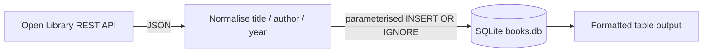
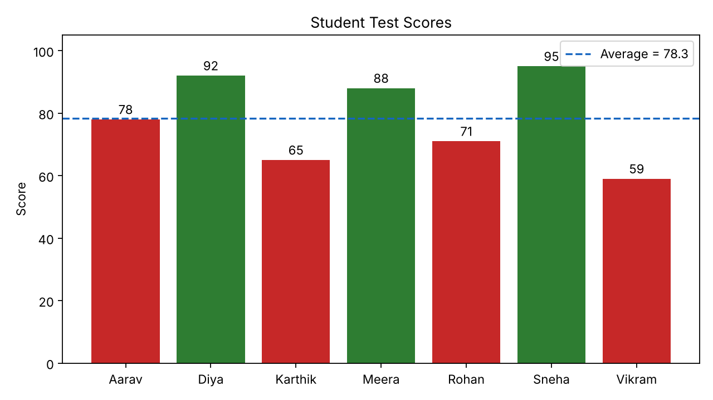
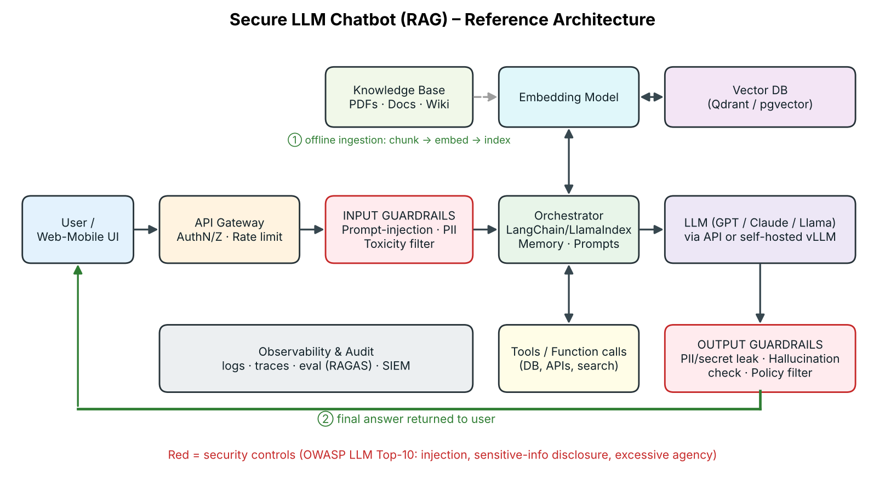
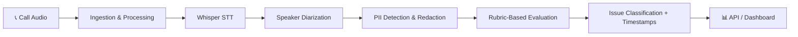

<div align="center">


---

[](https://python.org)
[](https://sqlite.org)
[](https://pytest.org)
[](#-security-by-design-principles)
[](LICENSE)

<br/>

> **Secure-by-design Python · Practical LLM & RAG architecture · Real-world AI security projects**

<br/>

[Assignment 1 →](#-assignment-1--python--database) &nbsp;|&nbsp; [Assignment 2 →](#-assignment-2--llm--ai--ml-knowledge) &nbsp;|&nbsp; [Assignment 3 →](#-assignment-3--project-i-am-proud-of) &nbsp;|&nbsp; [📄 Full PDF](docs/Reethika_Selvam_S_AI_Security_Assignment.pdf)

</div>

---

## 👩‍💻 Candidate

<table>
<tr><td><b>Name</b></td><td>Reethika Selvam S</td></tr>
<tr><td><b>Role Applied</b></td><td>AI Security Engineer Trainee – AccuKnox</td></tr>
<tr><td><b>GitHub</b></td><td><a href="https://github.com/Reethikaa05">github.com/Reethikaa05</a></td></tr>
<tr><td><b>LinkedIn</b></td><td><a href="https://www.linkedin.com/in/reethika-selvam-s-778484312">reethika-selvam-s</a></td></tr>
<tr><td><b>Portfolio</b></td><td><a href="https://reethika-portfolio.vercel.app/">reethika-portfolio.vercel.app</a></td></tr>
<tr><td><b>Email</b></td><td>reethikaa05@gmail.com</td></tr>
</table>

---

## 📌 Overview

This repository is my complete response to the AccuKnox AI Security Engineer Trainee technical assignment. Every task is treated as a **security engineering problem first, coding problem second** — inputs are validated, SQL is parameterised, network calls have timeouts, and re-running any script never corrupts data.

| # | Assignment | Key Deliverable | Folder |
|:-:|-----------|-----------------|--------|
| 1 | Python & Database (5 tasks) | 3 tested scripts + chart output | [`assignment-1-python-database/`](assignment-1-python-database/) |
| 2 | LLM / AI / ML Knowledge | Secure RAG architecture + vector DB analysis | [`assignment-2-llm-knowledge/`](assignment-2-llm-knowledge/) |
| 3 | Project I Am Proud Of | Voxora call-intelligence platform write-up | [`assignment-3-project/`](assignment-3-project/) |

> 📄 A combined PDF of all answers lives in [`docs/Reethika_Selvam_S_AI_Security_Assignment.pdf`](docs/Reethika_Selvam_S_AI_Security_Assignment.pdf).

---

## 🗂️ Repository Structure

```
ai-security-engineer-assignment/
├── README.md                               ← you are here
├── requirements.txt                        ← requests, matplotlib, pytest
├── LICENSE
│
├── assignment-1-python-database/
│   ├── README.md                           ← approach, run steps, sample output
│   ├── q1_books_api.py                     ← REST API → SQLite → display table
│   ├── q2_scores_chart.py                  ← API → average → bar chart (PNG)
│   ├── q3_csv_import.py                    ← CSV → validated SQLite import
│   ├── sample_data/
│   │   └── users.csv
│   ├── outputs/
│   │   ├── console_output.txt
│   │   └── scores_chart.png
│   └── tests/
│       └── test_csv_import.py              ← pytest suite (2 tests)
│
├── assignment-2-llm-knowledge/
│   ├── README.md                           ← self-rating, RAG arch, vector DB choice
│   └── images/
│       ├── arch_chatbot.png
│       ├── rag_flow.png
│       └── vectordb.png
│
├── assignment-3-project/
│   └── README.md                           ← Voxora write-up + "why it is hard"
│
└── docs/
    └── Reethika_Selvam_S_AI_Security_Assignment.pdf
```

---

## 🚀 Quick Start

```bash
# 1. Clone the repository
git clone https://github.com/Reethikaa05/AI-Security-Engineer-Assignment.git
cd AI-Security-Engineer-Assignment

# 2. Create and activate a virtual environment
python -m venv .venv
# Windows:
.venv\Scripts\activate
# macOS / Linux:
source .venv/bin/activate

# 3. Install dependencies
pip install -r requirements.txt

# 4. Run Assignment 1 scripts
cd assignment-1-python-database
python q1_books_api.py                        # Fetch books → SQLite → print table
python q2_scores_chart.py                     # Compute average → scores_chart.png
python q3_csv_import.py sample_data/users.csv # Import & validate users CSV
pytest -q                                     # Run test suite (2 passed)
```

> 💡 Every script **falls back to bundled sample data** when the network or API is unavailable, so a reviewer can always run it without internet access.

---

## 🔐 Security-by-Design Principles

A security mindset was embedded at every layer — not added as an afterthought.

| Principle | Implementation |
|-----------|---------------|
| **No SQL Injection** | Parameterised queries only (`?` placeholders throughout) |
| **Input Validation** | Email regex, numeric score checks, required-field enforcement |
| **Fail Safely** | `timeout=10` on all HTTP calls, `raise_for_status()`, graceful API fallback |
| **Idempotency** | `UNIQUE` constraints + `INSERT OR IGNORE` — re-runs never duplicate rows |
| **Transparency** | Bad rows are reported to stdout, never silently dropped |
| **Least Privilege** | Read-only tool execution, per-user ACL filtering at retrieval time, PII redaction on input and output (Assignment 2) |
| **Data Residency** | Qdrant (self-hosted) chosen over Pinecone so embeddings never leave the network |

---

## 🧩 Assignment 1 – Python & Database

> Five tasks covering REST API integration, data processing, visualization, and database security.

### Task 1 – API Data Retrieval & Storage
**[`q1_books_api.py`](assignment-1-python-database/q1_books_api.py)**



- Fetches the Open Library public API (no key required) with a 10-second timeout
- Parameterised SQL only; `UNIQUE(title, author)` constraint prevents duplicates

### Task 2 – Data Processing & Visualization
**[`q2_scores_chart.py`](assignment-1-python-database/q2_scores_chart.py)**

- Validates that every score is numeric before computing the mean via `statistics.mean`
- Generates a colour-coded bar chart (green ≥ average, red < average) with a dashed reference line

<div align="center">



*Console output: `Students: 7 | Average: 78.29 | Max: 95 | Min: 59`*

</div>

### Task 3 – CSV Import to Database
**[`q3_csv_import.py`](assignment-1-python-database/q3_csv_import.py)**

- Streams via `csv.DictReader` → constant memory regardless of file size
- Validates each row; normalises emails to lowercase
- `UNIQUE(email)` + `INSERT OR IGNORE` = idempotent, safe re-runs
- Invalid rows are logged, not silently discarded

### Task 4 – Most Complex Python Code
**[Voxora](https://github.com/Reethikaa05/Voxora)** · End-to-end AI call-intelligence pipeline

`audio → Whisper STT → speaker diarization → PII redaction → rubric scoring → issue classification`

Each stage's output is validated before flowing to the next; PII redaction is mandatory, not optional.

### Task 5 – Most Complex Database / Backend Code
**[ShopMCPilot](https://github.com/Reethikaa05/ShopMCPilot)** · Secure read-only MCP backend

Applies **least privilege** to AI agents: read-only tool execution, structured validated responses, PII masking, and AIMD adaptive rate-limiting — directly mitigating OWASP LLM Top 10 risks.

👉 Full details: [`assignment-1-python-database/README.md`](assignment-1-python-database/README.md)

---

## 🧠 Assignment 2 – LLM / AI / ML Knowledge

### Self-Rating

| Area | Rating | Evidence |
|------|:------:|----------|
| **LLM** | A | Voxora (Whisper + LLM eval + PII redaction), ai-resume-maker (GPT + Pinecone), ShopMCPilot (MCP security) |
| **Deep Learning** | B | TensorFlow neural nets (Pantech internship), audio-based grammar scoring model |
| **AI (general)** | A | End-to-end AI pipelines, RAG & retrieval, AI assistants, AI-agent security controls |
| **ML** | A | Classification, regression, clustering, feature engineering (scikit-learn + TensorFlow) |

### Secure RAG Chatbot Architecture

A **Retrieval-Augmented Generation** design that grounds answers in company data, reduces hallucination, and avoids model retraining when data changes.

<div align="center">



</div>

| Component | Role |
|-----------|------|
| **API Gateway** | OIDC/JWT auth, rate limiting, request-size limits |
| **Input Guardrails** | Prompt injection detection, PII redaction, toxicity filtering (Llama Guard / NeMo) |
| **Orchestrator** | LangChain / LlamaIndex — memory, prompt templates, tool routing, retries |
| **Vector DB** | Embeds chunks; retrieves top-k by cosine similarity |
| **LLM** | Hosted API or self-hosted (Llama / vLLM) based on data-residency requirements |
| **Output Guardrails** | Blocks secret/PII leakage, grounds answers in context, adds citations |
| **Observability** | Per-request tracing, RAGAS-style eval (faithfulness, relevance), SIEM alerts |

### OWASP LLM Top 10 Threat Mapping

| Threat | Example | Control |
|--------|---------|---------|
| **Prompt Injection** | Hidden instruction inside a retrieved document | Input guardrails; treat retrieved text as untrusted |
| **Sensitive-Information Disclosure** | Tenant A's data shown to Tenant B | Per-user ACL filter inside vector search; PII redaction |
| **Excessive Agency** | Agent runs a destructive action | Read-only tools; human approval for risky actions |
| **Data Poisoning** | Malicious content injected into knowledge base | Signed ingestion sources; provenance metadata |
| **Continuous Drift** | New jailbreaks appear over time | Red-team tests (garak, promptfoo) in CI |

### Vector Database: Why Qdrant

For a **5,000-employee** internal assistant over **~2M document chunks** requiring strict data residency and ACL enforcement:

> **Choice: Qdrant (self-hosted on Kubernetes)**
> 1. Payload filtering runs *inside* the ANN search — unauthorised chunks are never retrieved
> 2. Open-source + self-hosted → no embeddings leave the network; TLS, JWT, encryption at rest
> 3. HNSW + scalar quantisation handles 2M vectors with low latency on modest hardware

👉 Full details: [`assignment-2-llm-knowledge/README.md`](assignment-2-llm-knowledge/README.md)

---

## 🏆 Assignment 3 – Project I Am Proud Of

### Voxora — FitNova Call Intelligence Platform

<div align="center">

[](https://voxora-a0ss.onrender.com)
[](https://github.com/Reethikaa05/Voxora)

</div>

Voxora transforms raw customer-call audio into structured, evidence-backed insights and coaching feedback.



**Why it is technically hard:**
1. Turns unstructured, noisy audio with multiple speakers into timestamped, evidence-backed structured insights
2. Chains transcription → diarization → PII redaction → multi-dimensional scoring into one coherent, deployed pipeline
3. Keeps sensitive customer data protected throughout — privacy is mandatory, not optional

👉 Full details: [`assignment-3-project/README.md`](assignment-3-project/README.md)

---

## 🛠️ Tech Stack

<div align="center">

| Category | Technologies |
|----------|-------------|
| **Core Language** | Python 3.10+ |
| **Database** | SQLite (parameterised), Pinecone, Qdrant (design) |
| **AI / ML** | Whisper, LangChain / LlamaIndex (design), LLM APIs |
| **Networking** | requests (timeout-aware), REST APIs |
| **Visualization** | matplotlib |
| **Testing** | pytest |
| **Protocols** | MCP (Model Context Protocol) |

</div>

---

## ✅ Assumptions & Notes

1. **Python 3.10+** — third-party deps are only `requests` and `matplotlib` for Assignment 1.
2. **Books API** — uses the [Open Library](https://openlibrary.org/developers/api) public search endpoint (no key needed).
3. **Student-scores API** — endpoint is unspecified; assumed to return `[{"name": "...", "score": 0}]`. Change the `API` constant in `q2_scores_chart.py` to point to a real endpoint.
4. **Assignment 2 context** — answers assume an enterprise chatbot over private documents (RAG), where AI-security risk is highest.
5. **Offline fallback** — all Assignment 1 scripts include bundled sample data so reviewers can run them without network access.

---

## 📬 Contact

<div align="center">

**Reethika Selvam S**

[](https://github.com/Reethikaa05)
[](https://www.linkedin.com/in/reethika-selvam-s-778484312)
[](https://reethika-portfolio.vercel.app/)
[](mailto:reethikaa05@gmail.com)

</div>

---

<div align="center">


<sub>Released under the <a href="LICENSE">MIT License</a> · Built with ❤️ for AccuKnox</sub>
</div>
