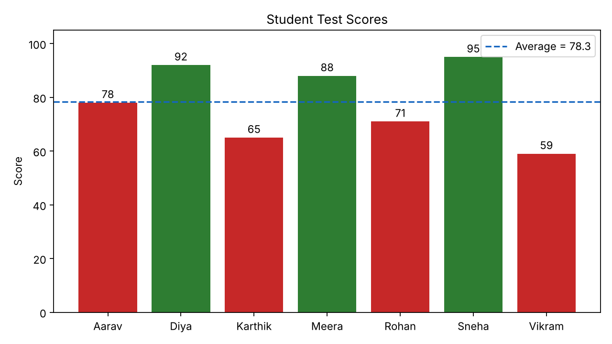

# Assignment 1 – Python & Database Problems

> Three runnable scripts, a pytest suite, and links to my most complex Python and backend work.

## Contents
- [Task 1: API → SQLite → display](#task-1--api-data-retrieval-and-storage)
- [Task 2: Scores → average → bar chart](#task-2--data-processing-and-visualization)
- [Task 3: CSV → SQLite](#task-3--csv-data-import-to-a-database)
- [Task 4: Most complex Python code](#task-4--most-complex-python-code)
- [Task 5: Most complex database / backend code](#task-5--most-complex-database--backend-code)
- [Running the tests](#running-the-tests)

## Task 1 – API Data Retrieval and Storage
**File:** [`q1_books_api.py`](q1_books_api.py)


**Design notes**
- `requests.get(..., timeout=10)` plus `raise_for_status()`; falls back to sample data if the API is unreachable.
- Table has `UNIQUE(title, author)`, so repeated runs do not create duplicates.
- Parameterised SQL only.

```text
ID  Title                                        Author                   Year
----------------------------------------------------------------------------------
3   The Pragmatic Programmer                     Andrew Hunt              1999
1   Clean Code                                   Robert C. Martin         2008
2   Designing Data-Intensive Applications        Martin Kleppmann         2017
```

## Task 2 – Data Processing and Visualization
**File:** [`q2_scores_chart.py`](q2_scores_chart.py)

- Fetches scores, **validates** that each is numeric, then computes the mean with `statistics.mean`.
- Green bars are at or above the average and red bars are below, with a dashed average line.
- Console result: `Students: 7 | Average: 78.29 | Max: 95 | Min: 59`



> **Assumption:** the API returns `[{"name": "...", "score": 0}]`. Change the `API` constant to use a real endpoint.

## Task 3 – CSV Data Import to a Database
**File:** [`q3_csv_import.py`](q3_csv_import.py) · **Sample:** [`sample_data/users.csv`](sample_data/users.csv)

- Streams the file with `csv.DictReader`, so memory use stays constant for large files.
- Validates each row (non-empty name, regex-checked email) and lower-cases emails.
- `UNIQUE(email)` plus `INSERT OR IGNORE` makes the import idempotent.
- Invalid rows are reported, not silently dropped.

```text
[skip] invalid row: {'name': 'Bad Row', 'email': 'not-an-email'}
inserted=3 skipped_invalid=1 total_in_db=3
```

## Task 4 – Most Complex Python Code
**Voxora – AI-Powered Call Intelligence Platform**
🔗 [GitHub](https://github.com/Reethikaa05/Voxora) · [Live](https://voxora-a0ss.onrender.com)

An end-to-end Python AI pipeline:
audio ingestion → Whisper transcription → speaker diarization and segmentation → PII detection and redaction → multi-dimensional rubric scoring → issue classification with timestamps and evidence.

**Why it is the most complex:** it chains several stages and models, each stage's output must be validated before the next, privacy (PII redaction) is built in, and it runs as a deployed service.

## Task 5 – Most Complex Database / Backend Code
**ShopMCPilot – Secure Read-Only MCP Integration**
🔗 [GitHub](https://github.com/Reethikaa05/ShopMCPilot)

Controlled, read-only access to product, order and inventory data for AI agents through the Model Context Protocol:
read-only tool execution, validated structured responses, PII masking, AIMD-based adaptive rate limiting, and a clean split between tool registration, execution and data access.

**Why it matters for AI security:** it applies least privilege to AI agents, which reduces the damage from prompt injection, data leakage and excessive agency (OWASP LLM Top 10).

## Running the Tests
```bash
pip install -r ../requirements.txt
pytest -q          # 2 passed
```
The tests cover validation, de-duplication, lower-casing of emails and idempotent re-imports for Task 3.
