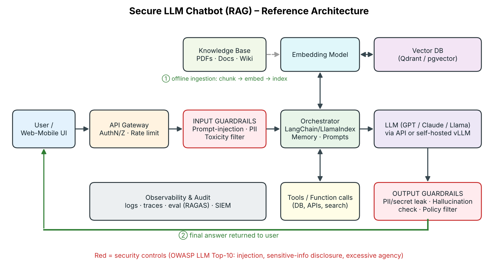
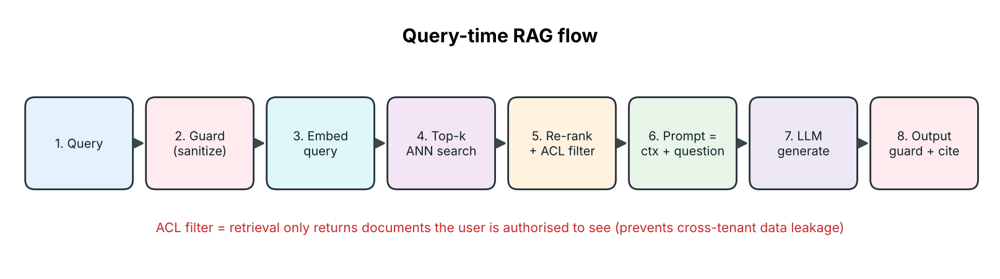
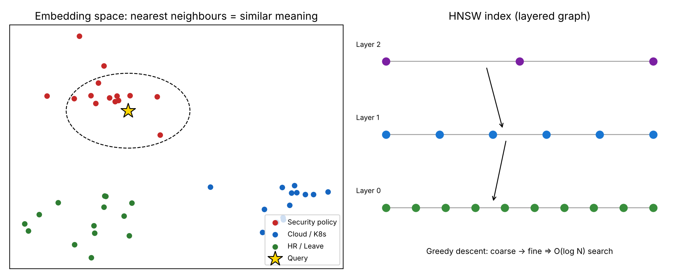

# Assignment 2 – LLM / AI / ML Knowledge

## 1. Self-Rating
`A` = can code independently · `B` = can code under supervision · `C` = little or no understanding

| Area | Rating | Evidence from my projects |
|------|:------:|---------------------------|
| LLM | **A** | Voxora: Whisper transcription, LLM-based call evaluation and PII redaction. ai-resume-maker: GPT + Pinecone semantic matching. ShopMCPilot: secure tool access for AI agents (MCP). |
| Deep Learning | **B** | TensorFlow neural networks and model evaluation during my ML internship (Pantech); audio-based grammar scoring model (grammar_score). |
| AI (general) | **A** | End-to-end AI pipelines (Voxora), RAG and retrieval (ai-resume-maker), AI assistants (EcoBazaar, ImageCraft AI), and AI-agent security controls (ShopMCPilot). |
| ML | **A** | Classification, regression, clustering and feature engineering with scikit-learn and TensorFlow; grammar_score regression model; KPI and funnel analytics. |

## 2. Key Architectural Components of an LLM Chatbot
I would build a **Retrieval-Augmented Generation (RAG)** chatbot. It grounds answers in company data, reduces hallucination, and avoids retraining the model whenever the data changes.

| Component | Role and key decision |
|-----------|-----------------------|
| Client UI + API gateway | Chat interface (web/Slack); authentication (OIDC/JWT), authorisation, rate limiting, request size limits. |
| Input guardrails | Detect prompt injection and jailbreaks, redact PII, filter toxicity (e.g. Llama Guard, NeMo Guardrails, regex plus classifier). |
| Orchestrator | LangChain or LlamaIndex: conversation memory, prompt templates, tool routing, retries and timeouts. |
| Ingestion pipeline (offline) | Load PDFs/wiki, clean, chunk (about 500 tokens with overlap), attach metadata (owner, ACL, source), embed, index. |
| Embedding model + vector DB | Converts text to vectors; retrieves the top-k similar chunks. |
| LLM | Hosted API (Claude/GPT) or self-hosted open model (Llama via vLLM) when data cannot leave the network. Choose by quality, cost, latency and data residency. |
| Tools / agents | Function calling to APIs or DBs with least privilege and human approval for risky actions (OWASP: Excessive Agency). |
| Output guardrails | Block secret/PII leakage, check that the answer is grounded in retrieved context, add citations. |
| Observability and evaluation | Trace each request, log prompts and outputs (with redaction), run RAGAS-style evals (faithfulness, relevance), alert the SIEM. |

### Query-time flow

### AI-security view
The main threats map to the **OWASP LLM Top 10**:

| Threat | Example | Control |
|--------|---------|---------|
| Prompt injection (direct / indirect) | A hidden instruction inside a retrieved document | Input guardrails, treating retrieved text as untrusted data, output checks |
| Sensitive-information disclosure | One tenant's data shown to another | Per-user ACL filter applied inside the vector search; PII redaction on input and output |
| Excessive agency / insecure tools | An agent runs a destructive action | Least-privilege, read-only tools; human approval for risky actions |
| Data poisoning | Malicious content added to the knowledge base | Signed and reviewed ingestion sources, provenance metadata |
| Continuous assurance | New jailbreaks appear over time | Red-team tests (garak, promptfoo) in CI |

## 3. Vector Databases
A **vector database** stores high-dimensional embeddings (for example 768 or 1536 numbers) that represent the *meaning* of text, images or logs, and finds the nearest vectors to a query using cosine similarity or dot product. A normal database matches exact values; a vector database matches meaning. "Reset my password" finds "forgot login credentials" even though they share no keywords.

**Why it is fast:** exact search over N vectors is O(N). Vector databases use Approximate Nearest Neighbour (ANN) indexes such as **HNSW** (a layered graph, roughly O(log N)), **IVF** (cluster, then search nearby clusters) and **PQ** (compression). They trade a little recall for large speed and memory gains.

| DB | Type | Strengths | Weaknesses |
|----|------|-----------|------------|
| pgvector | Postgres extension | One system, SQL joins, ACID, row-level security | Slower than specialised DBs at very large scale |
| Qdrant | Open-source, Rust | Fast, rich payload filtering, self-hostable | Another system to run |
| Pinecone | Managed SaaS | Zero ops, scales easily | Cost; data leaves your network |
| Milvus | Distributed OSS | Billions of vectors | Operationally heavy |
| FAISS / Chroma | Library / lightweight | Great for prototypes | Not a production multi-user service |

### Hypothetical problem
A security-aware internal assistant for **5,000 employees** over about **2 million chunks** of policies, runbooks and incident reports. Document-level permissions must be enforced, and data must stay in our own cloud for compliance.

### My choice: **Qdrant** (self-hosted on Kubernetes)
1. **Payload filtering:** ACL and tenant filters run *inside* the ANN search, so unauthorised chunks are never retrieved. This is the core security requirement.
2. **Data residency:** open source and self-hosted, so no embeddings or content go to a third party; supports TLS, API-key/JWT auth and encryption at rest.
3. **Performance:** HNSW with scalar quantisation handles 2M vectors with low latency on modest hardware, and it is cloud-native for Kubernetes.
4. **Trade-off accepted:** one more component to operate. For a corpus under about 500k chunks and a team already on Postgres, I would choose **pgvector** for simplicity and SQL joins.

> **Practical experience:** my `ai-resume-maker` project uses Pinecone for semantic matching, so I have worked with embeddings and vector search end to end.
